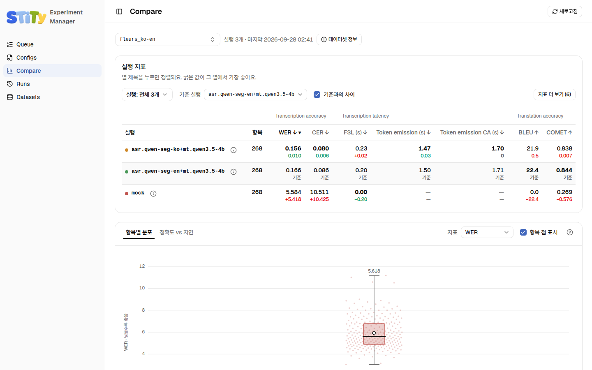
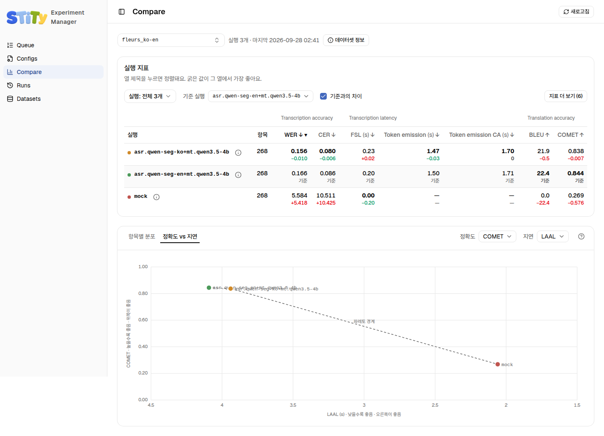

# Compare — 실행 비교하기

Compare 페이지는 **데이터셋 하나**를 골라 그 데이터셋으로 돈 실행들을 나란히 놓아요. 같은 녹음, 같은 번역 언어로 채점된 실행끼리만 모여요. 다른 데이터셋의 점수는 나란히 놓아도 비교가 안 되기 때문이에요. <!-- S01-C001-11 -->

## 데이터셋 고르기

맨 위 드롭다운에서 데이터셋 설정을 골라요. 이름의 첫 칸(`fleurs`, `northstar` 등)별로 묶여 있고 실행 수가 같이 나와요. **데이터셋 정보**를 누르면 그 설정의 설명과 태그가 나와요. <!-- S01-C001-11 S09-C001-08 -->

## 실행 지표 표 읽기

점수는 종류별로 묶여 나와요. 받아쓰기와 번역 각각의 정확도와 지연, 그리고 언어 판정과 분절이에요. <!-- S01-C001-11 -->

- 열 제목의 ↓는 낮을수록, ↑는 높을수록 좋다는 뜻이에요.
- 열마다 가장 좋은 값이 **굵게** 나와요.
- 열 제목을 누르면 정렬돼요.
- 처음에는 7열까지만 보여요. 나머지는 **지표 더 보기**를 눌러 펼쳐요.
- 실행 이름을 누르면 그 실행의 [Replay](./replay)로 가요.

<!-- S01-C001-11 S09-C001-08 -->

### 기준 실행과 차이

값 아래 작은 숫자는 **기준 실행**과 비교한 차이예요. 나아졌으면 초록, 나빠졌으면 빨강이에요.

기준 실행은 표 위 드롭다운에서 고르고, 기본은 첫 실행이에요. 차이를 끄려면 **기준과의 차이** 체크를 풀어요. 실행이 하나뿐이면 기준과 차이는 숨어요. <!-- S01-C001-11 S09-C001-08 -->

위 그림에서는 `asr.qwen-seg-en+mt.qwen3.5-4b`가 기준이에요. `asr.qwen-seg-ko+mt.qwen3.5-4b`의 WER 아래 `-0.010`은 기준보다 0.010 낮다는 뜻이에요. WER은 낮을수록 좋아서 초록으로 나와요. <!-- S09-C001-08 -->

### 실행 빼기

표 위 **실행:** 메뉴에서 보고 싶지 않은 실행을 뺄 수 있어요. 표와 아래 두 그림이 모두 따라 바뀌어요. 아직 도는 실행은 `running`으로 나오고, 지금까지 끝낸 항목 수가 같이 나와요. <!-- S01-C001-11 -->

## 항목별 분포

평균 하나만 보면 몇몇 항목이 크게 틀린 건지, 전부 조금씩 틀린 건지 알 수 없어요. **항목별 분포** 탭은 실행마다 항목 점수의 퍼진 모양을 세로 기둥으로 그려요. <!-- S01-C001-11 -->

| 그림 요소 | 뜻 |
|---|---|
| 상자 | 항목의 가운데 50% (25~75%) |
| 상자 안 굵은 선 | 중앙값 |
| 마름모 | 평균 |
| 위아래 수염 끝 | 최솟값과 최댓값 |
| 옅은 점 | 항목 하나하나. **항목 점 표시**로 끄고 켜요 |

<!-- S01-C001-11 -->

오른쪽 위 **지표** 드롭다운으로 그릴 점수를 바꿔요.

## 정확도 vs 지연

**정확도 vs 지연** 탭은 정확도 하나와 지연 하나를 골라 실행을 점으로 찍어요. 두 축 모두 **오른쪽과 위쪽이 좋은 쪽**이 되도록 낮을수록 좋은 축은 뒤집어 그려요. <!-- S01-C001-11 -->

점선은 **파레토 경계**예요. 두 축 모두에서 더 나은 다른 실행이 없는 실행들을 이은 선이에요. 이 선에 놓인 실행만 "어느 한쪽에서는 최선"이에요. 선에서 먼 실행은 두 축 모두에서 지는 실행이에요. <!-- S01-C001-11 -->

아직 도는 실행은 최종 점수가 없어서 빠져요. 빠진 실행과 이유는 그림 아래에 적혀요. <!-- S01-C001-11 -->

::: tip 링크로 공유하기
고른 데이터셋, 지표, 정렬은 주소의 `?` 뒤에 남아요. 새로 고쳐도 그대로이고, 주소를 보내면 같은 화면이 열려요.
:::

<!-- S01-C001-11 -->
