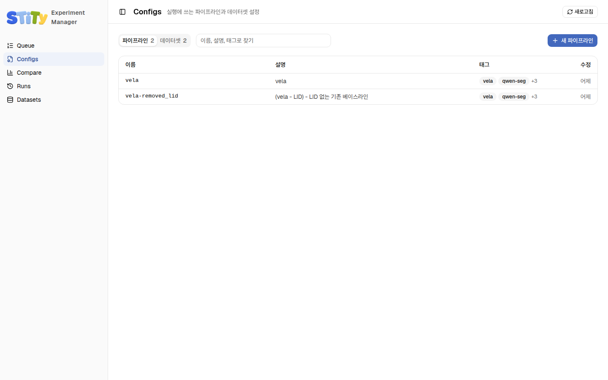
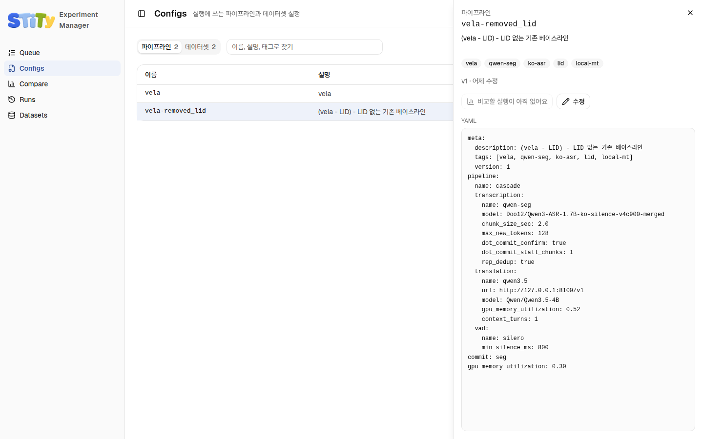
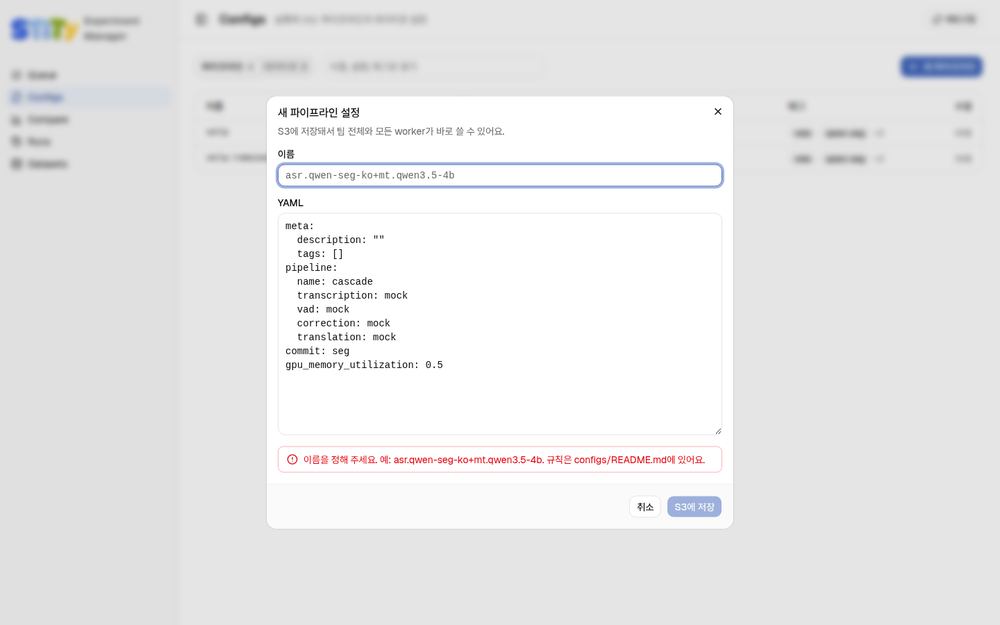

# Configs — 설정 만들기

Configs 페이지는 팀 S3에 있는 설정 파일 목록이에요. 여기서 만든 설정은 바로 팀
전체와 모든 GPU 머신이 써요. 실험은 언제나 **파이프라인 설정 하나 + 데이터셋
설정 하나**로 정해져요. <!-- S01-C001-13 S09-C001-06 S01-C001-01 -->

## 목록 보기

- 위쪽 **파이프라인** / **데이터셋** 탭으로 종류를 바꿔요. 숫자는 그 종류의 설정
  개수예요.
- 최근에 바뀐 설정이 위에 와요.
- 검색칸에 이름, 설명, 태그를 쳐서 걸러요.

<!-- S01-C001-13 S09-C001-05 -->

## 설정 하나 자세히 보기

줄을 누르면 오른쪽에 그 설정의 YAML 전체, 태그, 버전, 바뀐 때가 나와요.

<!-- S01-C001-13 S09-C001-05 -->

**실행 비교**는 이 설정으로 돈 실행을 [Compare](./compare)에서 열어요. 아직 돈
실행이 없으면 "비교할 실행이 아직 없어요"로 꺼져 있어요.

<!-- S01-C001-13 S09-C001-14 -->

## 새 설정 만들기

1. 만들 종류의 탭을 고르고 **새 파이프라인** 또는 **새 데이터셋**을 눌러요.
2. **이름**을 적어요. 이름 규칙은 [이름 규칙과 버전](../bench/naming)에 있어요.
3. **YAML** 칸에 설정 내용을 적어요. 처음이라면 비슷한 설정을 열어 YAML을 복사한
   뒤 바꿔요.
4. 칸 아래에 **저장할 수 있어요**가 초록으로 나오면 **S3에 저장**을 눌러요.

<!-- S01-C001-13 S09-C001-06 S09-C001-14 -->

적는 동안 이름 규칙, YAML 문법, 키 이름을 bench와 같은 검사기로 바로 확인해요.
문제가 있으면 칸 아래에 이유가 빨갛게 나와요. <!-- S01-C001-13 S09-C001-14 -->

| 칸 아래 메시지                               | 뜻과 할 일                                                                                  |
| -------------------------------------------- | ------------------------------------------------------------------------------------------- |
| 이름을 정해 주세요                           | 이름이 비어 있어요                                                                          |
| 같은 이름이 이미 있어요                      | 다른 이름을 골라요                                                                          |
| ○○ 이름은 ○○님이 … 다른 내용으로 이미 썼어요 | 그 이름으로 다른 내용이 이미 실행됐어요. **버전 올리기** 버튼을 눌러 다음 버전으로 저장해요 |
| 저장할 수 있어요                             | 저장해도 돼요                                                                               |

<!-- S09-C001-14 S01-C001-15 -->

YAML에 쓰는 키는 [설정 파일 쓰기](../bench/configs)에 있어요.

## 이름과 설명 고치기

설정을 열고 **수정**을 누르면 이름, 설명, 태그, 버전만 고칠 수 있어요. YAML의
나머지는 한 글자도 바뀌지 않아요. <!-- S01-C001-13 S09-C001-14 -->

- 이름을 바꾸면 S3에서 설정 파일이 옮겨져요. 지난 실행은 원래 이름을 그대로
  써요.
- 모델이나 값처럼 **재는 내용**을 바꾸려면 고치지 말고 새 설정을 만들어요. 새
  이름을 짓거나 버전을 올려요.

<!-- S01-C001-13 -->

::: warning 동시에 고치면 두 사람이 같은 설정을 동시에 고치면 늦게 저장한 쪽이
막혀요. "수정하는 사이에 다른 사람이 이 설정을 바꿨어요"가 나오면 최신 내용을
다시 연 뒤 고쳐요. :::

<!-- S01-C001-13 S09-C001-14 -->
