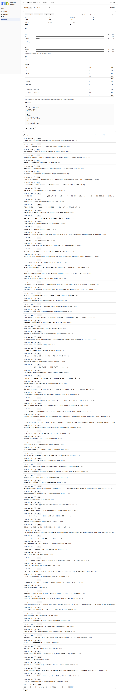
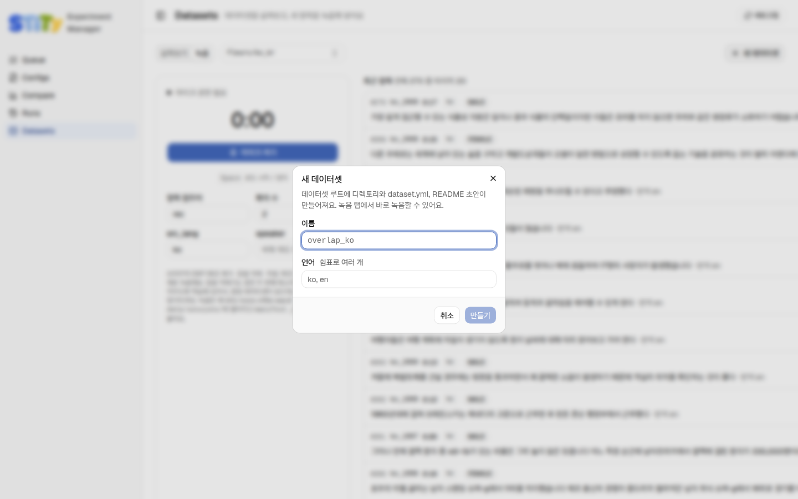
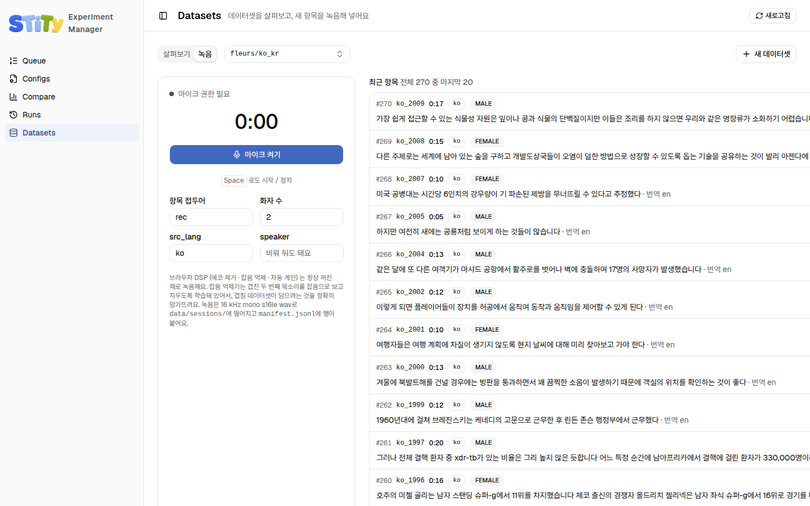

# Datasets — 데이터셋 살펴보기와 녹음

Datasets 페이지는 데이터 루트(`STITY_DATA_ROOT`)에 있는 데이터셋을 열어 봐요. 녹음을 들어 보고, 정답 문장을 확인하고, 마이크로 새 항목을 녹음해 넣을 수 있어요. 탭은 **살펴보기**와 **녹음** 두 개예요. 여기서 만든 데이터셋은 [설치를 거쳐야](#use-in-bench) bench 실험에 쓸 수 있어요. <!-- S06-C001-01 S06-C001-09 -->

::: warning 이 페이지는 실험 매니저를 띄운 컴퓨터의 파일을 바로 고쳐요
S3가 아니라 그 컴퓨터의 `datasets` 폴더를 고쳐요. 다른 머신에는 반영되지 않아요. 지운 것은 되돌릴 수 없어요.
:::

<!-- S06-C001-08 S06-C001-04 -->

## 데이터셋 고르기

탭 오른쪽 드롭다운에서 데이터셋을 골라요. `fleurs/en_us`, `fleurs/ko_kr`처럼 코퍼스별로 묶여 있고, 항목 수와 총 길이가 같이 나와요. 고른 데이터셋은 주소에 `?ds=fleurs/ko_kr`처럼 남아요. <!-- S06-C001-01 S06-C001-03 -->

## 살펴보기

맨 위 요약은 데이터셋 전체의 모양이에요. <!-- S06-C001-05 -->

| 칸 | 뜻 |
|---|---|
| 파일 배지 | `dataset.yml`, `manifest.jsonl`, `alignment.jsonl`, `README.md`, `convert.py`. 없는 파일은 흐리게 나와요 |
| 항목, 총 길이 | 녹음 개수와 전체 길이 |
| 세션 (group) | 한 대화나 발표로 묶인 단위의 개수 |
| 오디오 파일 | 오디오 파일 수. 빠진 파일이 있으면 빨갛게 "○개 없음"이 붙어요 |
| 길이 초 | 항목 길이의 분포 |
| src_lang | 원래 말한 언어별 항목 수 |
| 참조 | 정답 받아쓰기와 정답 번역이 채워진 비율 |
| 정렬 | 단어마다 말한 시각을 담은 `alignment.jsonl`이 있는지 |
| 행의 필드 | `manifest.jsonl`의 각 줄에 들어 있는 키 목록 |

<!-- S06-C001-05 -->

맨 아래 **verify() 돌리기**를 누르면 데이터셋이 정해진 형식을 지키는지 검사해요. 결과가 초록이면 통과, 빨강이면 문제가 있는 거예요. <!-- S06-C001-05 -->

### 항목 찾고 듣기

요약 아래 **항목** 목록에서 녹음을 하나씩 봐요. 검색칸에 id, 받아쓰기, 번역, 화자를 쳐서 찾아요. 100개씩 나오고 **더 보기**로 더 불러요. <!-- S06-C001-03 -->

항목을 누르면 오른쪽에 자세한 창이 열려요. 소리를 듣고, 정답 받아쓰기와 번역을 봐요. 단어 시각이 있으면 단어를 눌러 그 자리부터 들을 수 있어요. <!-- S06-C001-04 -->

::: danger 삭제 버튼 두 개
- **오디오 삭제**: wav 파일만 지워요. 변환한 데이터셋의 `audio`는 원본 코퍼스로 이어진 링크라서 **원본 파일이 지워져요**.
- **항목 삭제**: `manifest.jsonl`의 그 줄과 오디오를 함께 지워요.

둘 다 되돌릴 수 없어요. 또 `convert.py`를 다시 돌리면 `manifest.jsonl`이 새로 만들어져서 여기서 고친 내용이 사라져요.
:::

<!-- S06-C001-04 S06-C001-10 -->

## 새 데이터셋 만들기

1. 오른쪽 위 **새 데이터셋**을 눌러요.
2. **이름**을 적어요. 영문, 숫자, `_`, `-`만 쓰고 64자 이내예요. 예: `overlap_ko`
3. **언어**를 쉼표로 나눠 적어요. 예: `ko, en`
4. **만들기**를 눌러요.

<!-- S06-C001-02 -->

데이터 루트 아래에 새 폴더와 `dataset.yml`, `README.md` 초안이 생겨요. 만든 데이터셋은 바로 녹음 탭에서 쓸 수 있어요. 실험에 쓰려면 따로 설치해야 해요([아래](#use-in-bench)). <!-- S06-C001-02 -->

## 녹음하기

1. 녹음할 데이터셋을 고르고 **녹음** 탭을 열어요.
2. 필요하면 칸을 채워요. 모두 비워 둬도 돼요.
   - **항목 접두어**: 항목 이름 앞부분이에요. 기본 `rec`
   - **화자 수**: 녹음에 나오는 사람 수예요. 기본 2
   - **src_lang**: 말할 언어 코드예요. 예: `ko`
   - **speaker**: 말하는 사람 이름이에요
3. **마이크 켜기**를 누르고 브라우저의 마이크 권한을 허락해요. 이 버튼은 마이크만 열고 녹음은 아직 시작하지 않아요.
4. **녹음 시작**을 누르거나 스페이스바를 눌러요.
5. 다 말했으면 **정지**를 누르거나 스페이스바를 다시 눌러요.
6. "저장됐어요 · <항목 이름>"이 나오면 끝이에요. 오른쪽 **최근 항목**에 새 줄이 생겨요.

<!-- S06-C001-06 S09-C001-10 -->

녹음은 `data/sessions/<항목 이름>.wav`로 저장되고 `manifest.jsonl`에 한 줄이 붙어요. 항목 이름은 `rec_20261009_153000`처럼 접두어와 녹음한 시각으로 정해져요. <!-- S06-C001-06 S06-C001-07 -->

::: info 녹음할 때 알아 둘 것
- 소리는 16 kHz, 모노로 녹음해요. 브라우저의 에코 제거, 잡음 억제, 자동 음량 조절은 늘 꺼요. 잡음 억제가 겹쳐 말하는 두 번째 목소리를 지워 버리기 때문이에요.
- 0.25초보다 짧은 녹음은 버려요.
- 녹음은 **정지**를 눌러야 올라가요. 녹음 중에 탭을 닫으면 그 녹음은 사라져요.
- 받아쓰기 칸은 비어 있는 채로 저장돼요. 정답 문장은 이 페이지에서 적을 수 없어요.
- `dataset.yml`에 없는 언어로 녹음하면 그 언어가 `languages`에 더해져요. 오타를 내면 그 오타가 언어로 들어가요.
- 마이크는 `localhost`나 `https` 주소에서만 켜져요. 원격 서버라면 [SSH 터널](../getting-started/remote)로 열어요.
:::

<!-- S06-C001-06 S06-C001-07 -->

## 여기서 만든 데이터셋으로 실험하기 {#use-in-bench}

bench는 설치가 끝났다는 표시(`.status` 파일의 `success`)가 있는 데이터셋만 읽어요. 이 페이지는 그 표시를 쓰지 않아요. 그래서 여기서 만들거나 녹음한 데이터셋은 바로 실험에 쓸 수 없어요. <!-- S06-C001-09 S01-C001-35 -->

실험에 쓰려면 datasets 저장소의 `recipes.yml`에 그 데이터셋을 한 줄 더한 뒤 `make install NAME=<이름>`으로 설치해요. 설치 스크립트는 `recipes.yml`에 없는 이름을 거절해요. <!-- S10-C001-04 S10-C001-02 -->
