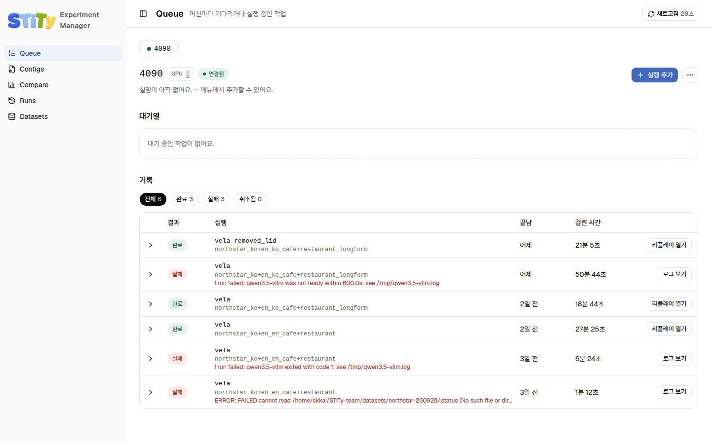

# 실험 매니저

실험 매니저(bench manager)는 실험을 넣고 결과를 보는 웹사이트예요. 실험을 GPU 머신의 대기열에 넣으면 그 머신이 정해진 시간에 돌려요. 결과는 팀 S3에 올라가서 누구나 비교하고 다시 재생할 수 있어요. <!-- S01-C001-03 -->



## 켜기

```bash
cd ~/STiTy
make bench-manager
```

처음 한 번은 웹사이트에 필요한 Node.js 패키지를 받느라 시간이 걸려요. 준비가 되면 이런 줄이 나와요. <!-- S04-C001-02 S08-C001-01 -->

```
  VITE v8.3.2  ready in 469 ms

  ➜  Local:   http://localhost:29140/
manager API on http://127.0.0.1:29130/api  (14 runs)
```

브라우저에서 `http://localhost:29140`을 열어요. GPU 서버에서 띄웠다면 [원격 서버에서 쓰기](../getting-started/remote)의 SSH 터널을 먼저 열어요. 끌 때는 그 터미널에서 `Ctrl+C`를 눌러요. 웹사이트와 API 서버가 함께 꺼져요. <!-- S01-C001-05 S01-C001-09 -->

::: warning 켜기 전에 확인할 것
- `.env`에 `STITY_DATA_ROOT`가 있어야 해요. 없으면 API 서버가 바로 멈춰요.
- Queue와 Configs 페이지는 `.env`에 S3 버킷과 AWS 키가 있어야 써요. 없으면 Compare와 Replay는 이 컴퓨터의 실행만 보여요.

자세한 것은 [.env 설정하기](../getting-started/env)에 있어요.
:::

<!-- S05-C001-03 S01-C001-31 -->

## 페이지 여섯 개

왼쪽 사이드바에서 골라요.

| 페이지 | 하는 일 |
|---|---|
| [Queue](./queue) | GPU 머신마다 대기열을 보고, 실험을 넣고, 끝난 job을 확인해요 |
| [Configs](./configs) | 파이프라인 설정과 데이터셋 설정을 보고 새로 만들어요 |
| [Runs](./runs) | 모든 머신의 실행을 한 표에서 찾고 걸러요 |
| [Compare](./compare) | 한 데이터셋으로 돈 실행들의 점수를 나란히 비교해요 |
| [Replay](./replay) | 실행 하나를 휴대폰 화면처럼 다시 재생해요. Runs에서 열어요 |
| [Datasets](./datasets) | 데이터셋 내용을 살펴보고 새 녹음을 넣어요 |

<!-- S01-C001-10 S01-C001-11 S01-C001-12 S01-C001-13 S01-C001-36 S06-C001-01 S09-C001-01 -->

## 실험 하나를 처음부터 끝까지

1. [Configs](./configs)에서 쓸 파이프라인 설정과 데이터셋 설정이 있는지 봐요. 없으면 새로 만들어요.
2. [Queue](./queue)에서 머신 탭을 고르고 **실행 추가**로 job을 넣어요.
3. 머신의 시간표가 열리면 worker가 job을 돌려요. 끝나면 Queue의 **기록**에 `완료`로 남아요.
4. [Runs](./runs)나 [Compare](./compare)에서 점수를 보고, [Replay](./replay)로 문제 문장을 들어 봐요.

<!-- S01-C001-03 S01-C001-36 S01-C001-37 -->

## 옵션

Replay의 항목 목록 맨 위에는 점수가 가장 나쁜 항목 10개가 먼저 나와요. 이 개수를 바꾸려면 `TOPK`를 붙여 켜요. <!-- S01-C001-12 S04-C001-02 -->

```bash
make bench-manager TOPK=20
```
