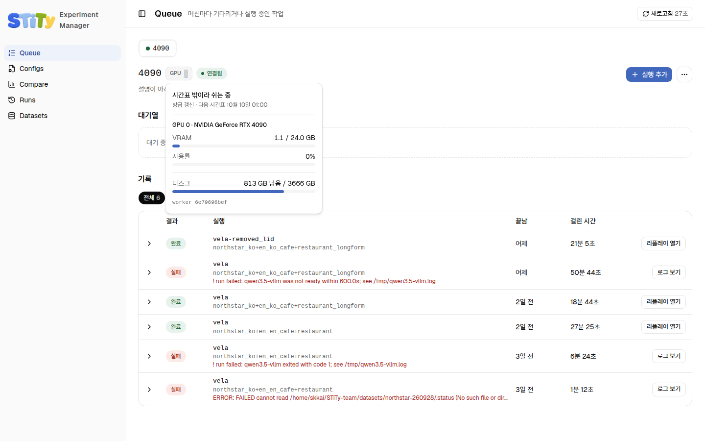
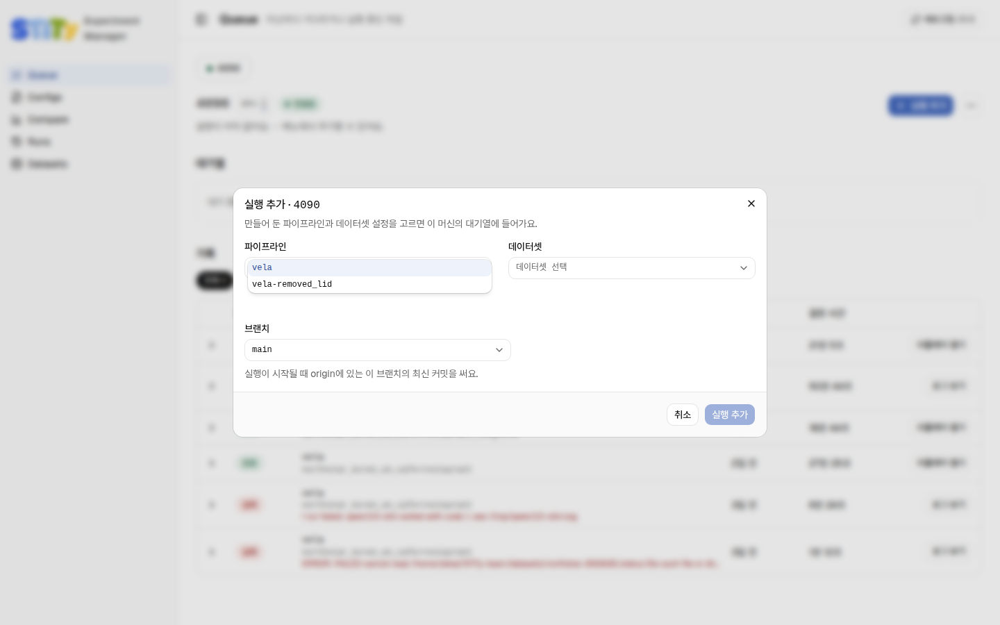
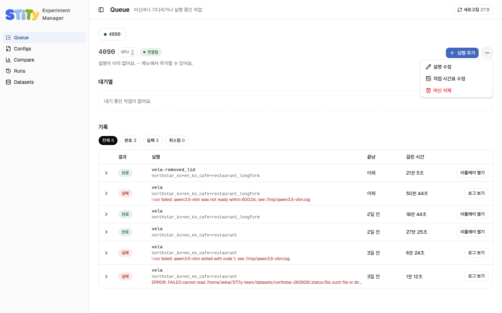
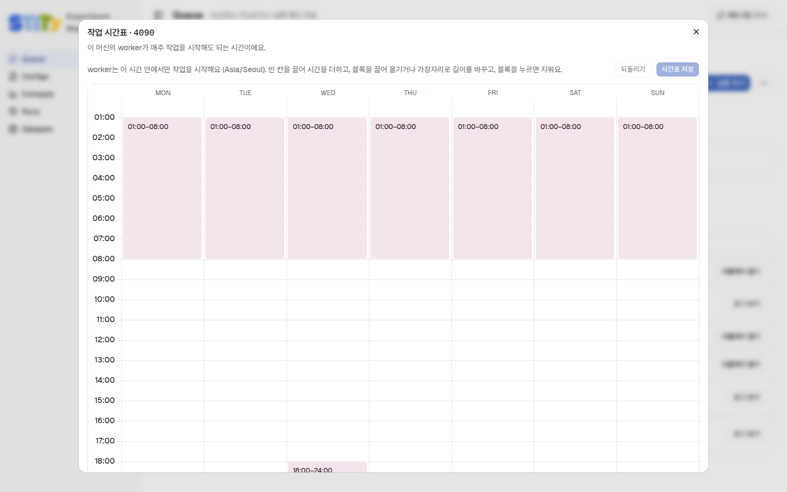

# Queue — 실험 넣기

Queue 페이지에서 GPU 머신을 골라 실험(job)을 넣어요. 그 머신의 worker가 정해진 시간표 안에서 넣은 순서대로 돌려요. 머신마다 탭이 하나씩 있어요. <!-- S01-C001-36 S01-C001-37 -->

## 머신 상태 읽기

탭 이름 앞의 점은 머신의 연결 상태예요. <!-- S01-C001-36 -->

| 점 색 | 뜻 |
|---|---|
| 초록 | 연결됨. worker가 살아 있어요 |
| 파랑 | 작업을 돌리는 중이에요 |
| 빨강 | 연결 끊김. worker 소식이 5분 넘게 없어요 |

머신 이름 옆의 **GPU** 막대는 GPU마다 하나씩 있어요. VRAM이 찬 만큼 차오르고 90%를 넘으면 빨개져요. 막대에 마우스를 올리면 자세한 상태가 나와요. <!-- S01-C001-36 -->

위 그림에서는 이런 것을 읽을 수 있어요. <!-- S09-C001-04 -->

- **시간표 밖이라 쉬는 중**: 지금은 시간표가 닫혀 있어요. 다음 시간표가 열리는 때가 아래에 나와요.
- **VRAM**, **사용률**: GPU 메모리를 얼마나 쓰고 있는지, 얼마나 바쁜지예요.
- **디스크**: 머신에 남은 저장 공간이에요.

## 실험 넣기

::: warning 코드를 바꿨다면 먼저 push해요
job은 시작할 때 GitHub(`origin`)에 있는 그 브랜치의 **최신 커밋**으로 돌아요. 내 컴퓨터에만 있는 변경은 쓰이지 않아요. 고친 코드로 돌리려면 커밋해서 push한 뒤 넣어요.
:::

<!-- S01-C001-33 S09-C001-02 -->

1. 위쪽 탭에서 돌릴 머신을 골라요.
2. 오른쪽 위 **실행 추가**를 눌러요.
3. **파이프라인**에서 파이프라인 설정을 골라요. 고르면 아래에 설명이 나오고, **YAML 보기**로 내용을 펼쳐 볼 수 있어요.
4. **데이터셋**에서 데이터셋 설정을 골라요.
5. **브랜치**를 골라요. 보통 `main`이에요.
6. 아래쪽 **실행 추가**를 눌러요. 대기열에 job이 하나 생겨요.

<!-- S01-C001-36 S09-C001-02 -->

조합이 여러 개면 하나씩 넣어요. 목록에 원하는 설정이 없으면 [Configs](./configs)에서 먼저 만들어요. <!-- S01-C001-36 -->

::: info 넣을 때 막히는 경우
넣는 순간 설정 YAML을 bench와 같은 검사기로 확인해요. 같은 이름이 이미 다른 내용으로 쓰였으면 넣지 못해요. 이때는 [이름 규칙과 버전](../bench/naming)을 봐요.
:::

<!-- S01-C001-36 S01-C001-34 -->

job은 넣을 때의 설정 내용을 그대로 들고 가요. 넣은 뒤에 S3의 설정을 고쳐도 그 job이 재는 것은 바뀌지 않아요. <!-- S01-C001-13 -->

## 대기열 다루기

**대기열**에는 아직 끝나지 않은 job이 있어요. 먼저 넣은 job이 먼저 돌아요. 행 앞 화살표를 누르면 작업 ID, 넣은 때, 시작한 때, 돈 커밋이 펼쳐져요. <!-- S01-C001-36 S09-C001-12 -->

| 버튼 | 하는 일 |
|---|---|
| **지금 실행** | 시간표와 상관없이 바로 돌려요. 도는 job이 없으면 1분 안에 시작하고, 있으면 그 job이 끝난 뒤 가장 먼저 시작해요. 시간대가 끝나도 멈추지 않아요 |
| **취소** | 한 번 더 물은 뒤 job을 빼요. 대기 중이면 바로 빠지고, 돌고 있으면 worker가 다음 확인 때 멈춰요 |

<!-- S09-C001-12 S09-C001-13 S01-C001-36 -->

시간표가 끝나면 worker가 돌던 job을 멈추고 대기열로 되돌려요. 되돌려진 job은 다음 시간대에 처음부터 다시 시작해요. 어느 시간대보다 오래 걸리는 job은 계속 되돌려지기만 하니 취소하거나 **지금 실행**을 써요. <!-- S01-C001-36 S01-C001-37 S09-C001-12 -->

## 끝난 작업 보기

**기록**에는 이 머신에서 끝난 job 최근 100개가 있어요. **전체**, **완료**, **실패**, **취소됨** 칩으로 걸러요. <!-- S01-C001-36 S09-C001-01 -->

| 결과 | 버튼 | 하는 일 |
|---|---|---|
| 완료 | **리플레이 열기** | 그 실행을 S3에서 이 컴퓨터로 받아 [Replay](./replay)를 열어요 |
| 실패 | **로그 보기** | job 로그의 끝부분을 보여 줘요. 실패 원인 한 줄은 행에 빨갛게 나와요 |

<!-- S01-C001-36 S09-C001-01 -->

실패 원인을 읽는 법은 [자주 나는 오류](../bench/troubleshooting)에 있어요.

## 머신 설정 바꾸기

오른쪽 위 **⋯** 버튼에 메뉴가 셋 있어요. <!-- S09-C001-01 S09-C001-11 -->

| 메뉴 | 하는 일 |
|---|---|
| **설명 수정** | 팀이 함께 보는 머신 메모예요. 누가 쓰는 중인지, 고장 난 GPU가 있는지 적어요 |
| **작업 시간표 수정** | worker가 job을 시작해도 되는 시간을 정해요 (아래) |
| **머신 삭제** | 머신의 설명, 시간표, 기록을 모두 지워요. 되돌릴 수 없고 대기열의 job도 사라져요. 올라간 실행 결과는 남아요 |

<!-- S01-C001-36 S09-C001-11 -->

### 작업 시간표 정하기 {#timetable}

요일마다 시간 블록을 그려서 정해요. 시각은 그 머신의 표준 시간대(time zone, 기본 `Asia/Seoul`) 기준이에요. <!-- S01-C001-36 S09-C001-03 -->

| 하고 싶은 것 | 방법 |
|---|---|
| 시간 더하기 | 빈 칸을 위아래로 끌어요 |
| 옮기기 | 블록을 끌어요 |
| 길이 바꾸기 | 블록의 위나 아래 가장자리를 끌어요 |
| 지우기 | 블록을 눌러요 |
| 저장하기 | **시간표 저장**을 눌러요. 누르기 전에는 저장되지 않아요 |
| 고치기 전으로 | **되돌리기**를 눌러요 |

<!-- S01-C001-36 S09-C001-03 -->

- 30분 단위로 움직여요.
- 자정을 넘기는 시간은 블록 두 개로 그려요. 예를 들어 월 19:00–24:00과 화 00:00–09:00이에요. worker는 이어진 블록을 한 시간대로 봐요.
- 새로 등록된 머신은 매일 00:00–04:00으로 시작해요.
- 시간표가 비어 있으면 탭에 빨간 경고가 뜨고, 그 머신은 job을 시작하지 않아요.

<!-- S01-C001-36 S01-C001-39 -->

## 알아 두면 좋은 것

- 페이지는 30초마다 새로 읽어요. 고치고 있는 칸은 덮어쓰지 않아요.
- 두 사람이 같은 것을 동시에 고치면 늦게 저장한 쪽이 막혀요. 다시 열어 지금 값을 보고 고쳐요.
- job 로그는 머신의 `~/.local/state/stity/jobs/<job id>.log`에 있어요.

<!-- S01-C001-36 S01-C001-37 S01-C001-38 -->
