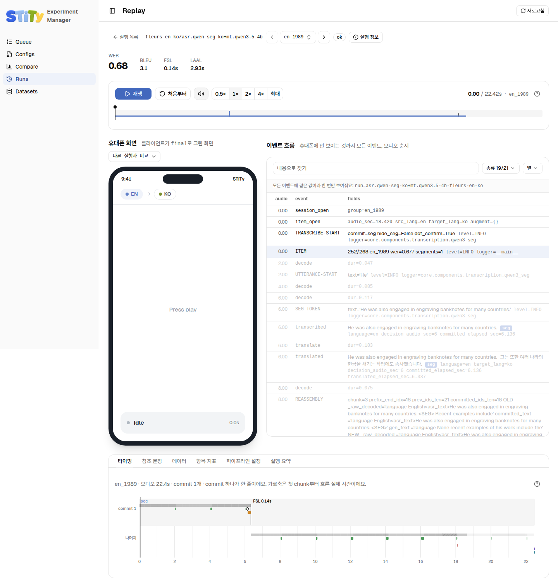

# Replay — 다시 재생하기

Replay는 실행 하나에서 **녹음 하나(항목)**를 골라, 휴대폰에 보였을 화면을 그 소리와 함께 다시 재생해요. 점수가 왜 나쁜지 귀와 눈으로 확인하는 곳이에요. 사이드바에는 없고 [Runs](./runs)나 [Queue](./queue)의 기록에서 열어요. <!-- S01-C001-12 -->

## 항목 고르기

맨 위 줄에 실행 이름과 항목 고르기가 있어요. 항목 이름을 눌러 목록을 열거나, `<` `>` 버튼으로 앞뒤 항목으로 넘겨요. 목록에서 이름으로 찾을 수도 있어요. <!-- S01-C001-12 S09-C001-09 S09-C001-15 -->

목록 맨 위에는 **볼 만한 항목**이 먼저 와요. <!-- S01-C001-12 S09-C001-15 -->

1. 실패했거나 받아쓴 것이 없는 항목 전부
2. 점수가 가장 나쁜 항목 10개. WER로 고르고, WER이 없으면 BLEU, 그것도 없으면 FSL로 골라요

나머지 항목은 그 아래에 모두 있어요. 10개를 바꾸려면 [실험 매니저를 켤 때](./) `TOPK`를 줘요. <!-- S01-C001-12 S04-C001-02 -->

제목 아래에 그 항목의 점수가 나와요. WER이 크게, BLEU·FSL·LAAL이 옆에 작게 나와요. **실행 정보**를 누르면 데이터셋과 파이프라인의 이름, 태그, 설명이 나와요. <!-- S01-C001-12 S09-C001-15 -->

## 재생하기

| 버튼 | 하는 일 |
|---|---|
| **재생** / **일시정지** | 재생을 시작하거나 멈춰요. 스페이스바도 같아요 |
| **처음부터** | 항목의 처음으로 돌아가요 |
| 스피커 | 소리를 켜고 꺼요 |
| `0.5×` `1×` `2×` `4×` **최대** | 재생 속도예요 |

<!-- S01-C001-12 S09-C001-15 -->

재생 막대 위의 짧은 세로 표시는 커밋이 나온 위치예요. <!-- S09-C001-15 -->

## 화면 두 개 읽기

| 왼쪽: 휴대폰 화면 | 오른쪽: 이벤트 흐름 |
|---|---|
| 휴대폰이 `final`로 그렸을 화면 그대로예요. 번역이 크게, 받아쓴 원문이 그 아래에 나와요. 흐린 말풍선은 아직 확정되지 않은 `partial`이에요 | 휴대폰에는 안 보이는 것까지 모든 이벤트가 오디오 순서대로 나와요. 받아쓰기, 커밋, 번역, 로그가 섞여 있어요 |

<!-- S01-C001-12 S01-C001-27 S09-C001-15 -->

두 화면은 같은 시계로 움직여요. 위쪽 언어 알약(`EN → KO`)은 그 항목의 언어 쌍이에요. <!-- S01-C001-12 -->

이벤트 흐름의 검색칸에 낱말을 쳐서 찾아요. 번역이 하나도 나오지 않은 항목이면 여기서 `[DROP]` 로그를 찾아봐요. 받아쓴 것을 왜 버렸는지 규칙 이름이 붙어 있어요. <!-- S01-C001-27 S09-C001-15 -->

## 다른 실행과 나란히 보기

휴대폰 화면 위 **다른 실행과 비교**에서 실행을 고르면 화면이 두 개가 돼요. 같은 녹음을 다른 모델이 어떻게 받아썼는지 바로 비교해요. <!-- S01-C001-12 S09-C001-15 -->

- 목록에는 **같은 데이터를 들은** 실행만 나와요. 데이터셋 이름이 같아도 소음을 입힌 버전(`_cafe` 등)은 다른 소리라서 나오지 않아요.
- 두 화면은 시계를 함께 쓰고, 소리는 첫 화면 것만 나요.

<!-- S01-C001-12 -->

## 아래 탭 여섯 개 {#tabs}

| 탭 | 보여 주는 것 |
|---|---|
| **타이밍** | 커밋 하나가 한 줄이에요. 오디오가 들어온 구간, 디코딩과 번역에 걸린 시간, 커밋이 정해진 순간(◆)과 그때의 FSL이 겹쳐 보여요. 가로축은 실제로 흐른 시간(초)이에요 |
| **참조 문장** | 그 항목의 정답 받아쓰기와 정답 번역 |
| **데이터** | 데이터셋에 들어 있는 원래 데이터. 구간, 언어, 화자, 소리 크기(peak / rms) |
| **항목 지표** | 이 항목 하나의 모든 점수 |
| **파이프라인 설정** | 이 실행이 쓴 설정 |
| **실행 요약** | 실행 전체의 요약. 실행이 끝나야 나와요 |

<!-- S09-C001-15 S01-C001-12 -->

커밋에는 이유가 붙어요. 타이밍 탭과 이벤트 흐름에서 이렇게 읽어요. <!-- S09-C001-15 S01-C001-24 -->

| 커밋 이유 | 뜻 |
|---|---|
| `seg` | 모델이 문장 끝을 표시했어요 |
| `vad` | 말이 끝나고 침묵이 이어졌어요 |
| `dot` | 마침표가 나왔어요 |
| `always` | 소리 조각마다 커밋했어요 |
| `finish` | 오디오가 끝나서 남은 것을 커밋했어요 |

::: tip 소리가 작은 구간 찾기
데이터 탭에서 소리가 작은 구간에는 `quiet`가 붙어요. VAD가 그런 구간을 놓치면 `partial`은 나왔는데 커밋이 사라질 수 있어요. 받아쓴 말이 갑자기 없어졌다면 여기를 먼저 봐요.
:::

<!-- S01-C001-12 -->

## 아직 도는 실행

도는 중인 실행도 열려요. 그때까지 끝난 항목만 보이고, **실행 요약** 탭은 실행이 끝나야 채워져요. <!-- S01-C001-12 S09-C001-15 -->
