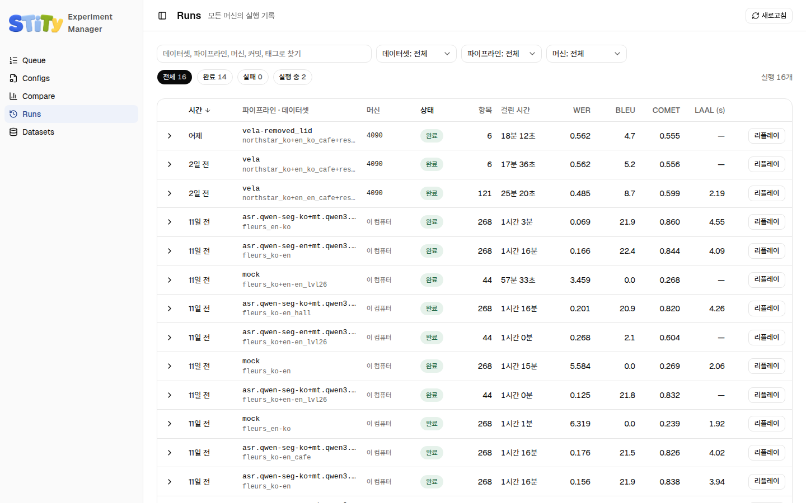
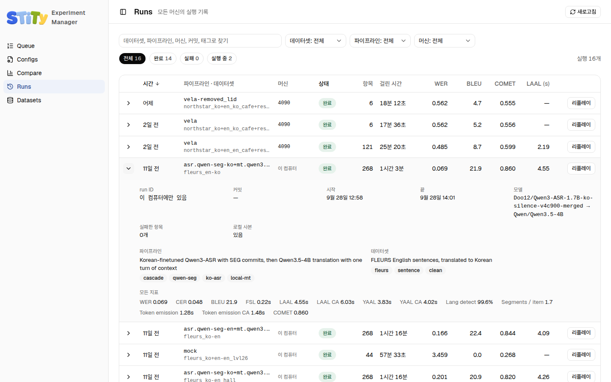

# Runs — 실행 찾기

Runs 페이지는 모든 머신의 실행을 한 표에 모아요. S3에 올라간 실행과 이 컴퓨터에만 있는 실행이 함께 나오고, 새 것이 위에 와요. 실행 하나를 골라 [Replay](./replay)로 여는 곳도 여기예요. <!-- S01-C001-10 -->

## 표 읽기

| 열 | 뜻 |
|---|---|
| 시간 | 실행이 시작된 때 |
| 파이프라인 · 데이터셋 | 위 줄이 파이프라인 설정, 아래 줄이 데이터셋 설정 이름 |
| 머신 | 실행이 돈 머신. `이 컴퓨터`는 지금 실험 매니저를 띄운 컴퓨터예요 |
| 상태 | `완료`, `실패`, `실행 중` |
| 항목 | 돌린 녹음 개수 |
| 걸린 시간 | 실행에 걸린 실제 시간 |
| WER, BLEU, COMET, LAAL | 주요 점수. 뜻은 [용어 정리](../getting-started/terms#metrics)에 있어요 |

<!-- S01-C001-10 S09-C001-07 -->

열 제목을 누르면 그 열로 정렬돼요. `—`는 그 실행이 낼 수 없는 점수예요. 예를 들어 발표 전체를 한 번에 흘린 실행에는 LAAL이 없어요. <!-- S01-C001-10 S01-C001-21 -->

## 찾고 거르기

- **검색칸**: 데이터셋, 파이프라인, 머신, 커밋, 태그를 찾아요. 빈칸으로 나눈 낱말이 모두 들어간 행만 남아요.
- **드롭다운**: 데이터셋, 파이프라인, 머신으로 걸러요.
- **상태 칩**: 전체, 완료, 실패, 실행 중으로 걸러요.

<!-- S01-C001-10 S09-C001-07 -->

거른 조건과 정렬은 주소창의 `?` 뒤에 남아요. 그 주소를 동료에게 보내면 같은 화면이 열려요. <!-- S01-C001-10 -->

## 실행 하나 펼치기

행 앞의 화살표를 누르면 자세한 정보가 펼쳐져요.

- run ID와 실행에 쓴 커밋
- 시작과 끝 시각
- 쓴 모델
- 두 설정의 설명과 태그
- 모든 점수와 실패 원인 <!-- S01-C001-10 -->

## 리플레이 열기

오른쪽 **리플레이**를 누르면 그 실행을 [Replay](./replay)로 열어요. <!-- S01-C001-10 -->

- 이 컴퓨터에 그 실행이 있으면 바로 열어요.
- 없으면 S3에서 `bench/runs/<데이터셋>/<파이프라인>/`으로 받아 와서 열어요.

::: warning 받아 오면 같은 자리의 실행이 바뀌어요
한 폴더에는 같은 데이터셋·파이프라인 조합의 실행이 하나만 있어요. 다른 머신의 실행을 받아 오면 그 자리에 있던 실행이 바뀌어요. 이 컴퓨터에만 있고 S3에 없는 실행이면 덮어쓰지 않고 막아요.
:::

<!-- S01-C001-10 S01-C001-26 -->
